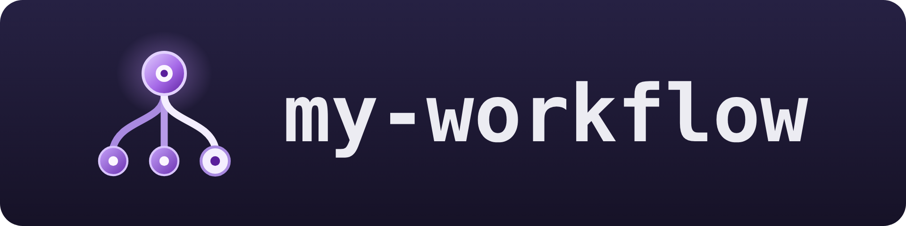
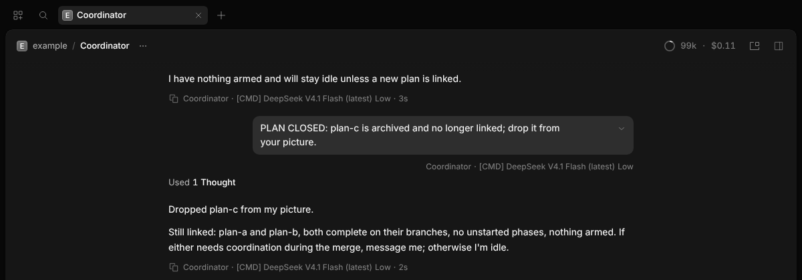

<p align="center">
  
</p>

<p align="center">
  An OpenCode workflow in which long-lived plan orchestrators build a project phase by phase, several
  plans in parallel, with a coordinator that settles their overlaps before they become merge
  conflicts.
</p>

<p align="center">
  <a href="https://github.com/aaronpiipponen/my-workflow/actions/workflows/ci.yml"></a>
  <a href="/LICENSE"></a>
  <a href="/plugins/workflow/package.json"></a>
</p>

---

**Contents**

- [Why it exists](#why-it-exists)
- [What exists in the project](#what-exists-in-the-project)
- [Features](#features)
- [Tech stack](#tech-stack)
- [Architecture](#architecture)
- [Data and limits](#data-and-limits)
- [Run your own copy](#run-your-own-copy)
- [License](#license)

## Why it exists

An agent left alone on a large change drifts: it forgets the plan, decides product questions it should ask about, and builds what nobody reviewed. This workflow splits the work into roles. A plan orchestrator owns one plan and works with the user on every product decision, while short-lived subagents detail, implement and review one phase at a time under rules injected into each role. An orchestrator can work for days between the user's inputs.

Because one orchestrator works for days between the user's inputs, running several plans side by side, each on its own branch, multiplies what gets built while the user's decisions stay the limit. That only pays off if their overlapping code does not end in merge conflicts and rework. The coordinator watches the parallel plans behind the scenes and, when two would collide, stops both at a fixed point and lets their orchestrators agree on one design first. The user keeps working with the orchestrators, not with the coordinator.

The rules themselves live in this one repository and reach every workspace through links and injection, so a fix to a rule lands everywhere at once, and each workspace keeps only its own values.

## What exists in the project

- `AGENT-INSTRUCTIONS/` holds the shared rules, the plan templates, the subagent sources and the SVG renderer every workspace links.
- `commands/` holds the `/plan` and `/release` orchestrator prompts.
- `plugins/` holds the runtime plugins: role context, coordination, foreground subagents, configuration reload, and the keepalive and shadow orchestrator submodules.
- `skills/` holds the procedure skills, whose content is the shared rule text itself.
- `setup/` holds the machine and workspace setup scripts and the templates of each workspace's own slots.
- `toy/` holds the toy project harness: creating, driving and recording test runs.
- `docs/` holds this workflow's documentation, diagrams, screenshot and logo.

## Features

### Orchestrators and their subagents

Each orchestrator is a long-lived chat session that owns decisions its subagents never make. A plan orchestrator, started with `/plan`, owns one plan's scope, phase sequence and handoff. A release orchestrator, started with `/release`, takes a finished plan through review, merge and closure. A shadow orchestrator, started with `/shadow-register`, sits above an interactive working session to hold its plan through a stream of small interface decisions. In autonomous mode, an orchestrator takes the routine decisions inside its plan's scope itself and records each one.

The orchestrators delegate to subagents, each receiving only its own rules: a phase detailer and implementer, read-only reviewers and scouts, and the writers that serve the release. The `coordinator` session and the `conflict-investigator` it starts watch the parallel plans and settle their overlaps.


### Plans and phases

A plan is a folder: `full-plan.md` holds the scope and the phase status table with one phase `active`, each open phase has an implementation-grade document, each finished one a frozen contract, and the orchestrator's handoff lets it resume where it stopped. `/plan-new` creates a plan's branch, worktree and starting files, and `/shadow-plan` creates a shadow plan for interactive work, with its one cleanup phase filled in and its working session open. Every phase keeps its id for life, and in a plan every implementer starts through `phase_subagent`, which records the phase on the child session and checks the coordinator's holds first.

### Parallel plans and the coordinator

Each plan has its own worktree and branch, so several orchestrators run side by side. `/coordinator-link` in an orchestrator's chat links it to the workspace's coordinator, which receives the plan once and then one feed message per orchestrator round: the orchestrator's messages, its children's shortened reports, the plan's changes, each phase's touched-files block and the phase documents that stopped being active. When two plans may change the same code, the coordinator has a `conflict-investigator` check the overlap instead of reading the details itself.



### Holds and the channel

A real overlap becomes a hold pair: each plan stops before its overlapping phase, and the refused implementer start records that it arrived. Once both have stopped, the coordinator opens a channel between the two orchestrators. They agree on one shared design. The leader has a resolution phase written into each plan from it, then closes the channel, which releases both holds. Commits never move between plan branches.

### Shared resource locks

A workspace names its shared resources, such as a deployed instance or a worker machine, and the shell commands each lock guards. A matching command is refused until the session or an ancestor holds the lock. A held lock can be queued for with `lock_request` and transfers to the first waiter on release, a reminder follows a lock that stays held, and a lock whose session is gone is released.

### Release, merge and hotfix

A release reviews and fixes the public changes, merges the plan branch into the integration branch, resolves conflicts with earlier plans by their shared designs and done contracts, runs the gates and closes the plan. Releases run one at a time, and the user makes every public commit and push. `/release` in the integration worktree is a hotfix with no plan.

### Shared rules, skills and guides

A bindings map decides which shared rules each role receives, and the workflow plugin injects them once per session so the model's read cache holds. Procedures that only some work needs are skills carrying the shared text itself, and the documentation, README and logo guides govern every page, diagram and logo. `AGENT-INSTRUCTIONS/TOOLS/render-svg` renders each visual for inspection, and edits to the shared rules wait until the session has loaded the `agent-instructions` skill.

### Toy runs

A small Rust raytracer tests the whole flow before it reaches a real project, and its runs live in [toy-raytracer](https://github.com/aaronpiipponen/toy-raytracer). `toy/run.py` creates an isolated run from a seed repository, and `toy/drive.py` starts the three plan orchestrators, links them, starts the three releases in order and ends with a documentation hotfix, leaving only the orchestrators' questions to the person running the test. Each finished run is recorded in the seed with the transcript of every top-level session.

The [documentation](/docs/README.md) has the user guide, the technical pages, the developer guide and setup.

## Tech stack

| Layer | Technology | Role |
|---|---|---|
| Agent runtime | OpenCode 2.4.1 | Runs the orchestrator, coordinator and subagent sessions |
| Plugins | Node.js 22, ES modules | Inject role context, coordinate plans, wait for children |
| Workflow text | Markdown and JSON | Rules, bindings, commands and skills |
| Setup and toy harness | Python 3 | Machine wiring, workspace links, run creation, driving and recording |
| Diagrams and logo | Hand-written SVG | Documentation visuals |
| Continuous integration | GitHub Actions | Plugin suites and Python checks |

## Architecture

The workflow repository owns every rule, plugin and setup script, and a change to it reaches every workspace. A workspace owns its own values in its `LOCAL/` slots, its plan folders and coordinator state in the workspace root, and one Git worktree per plan. The workflow plugin turns the shared rules into each session's context, and the coordinator plugin keeps the parallel plans apart. The user owns every product decision and every public commit.

The delivery path from this repository into a running session:


A workspace with parallel plans, where the user works with the orchestrators and the coordinator runs behind them:


### Repository layout

- [`AGENT-INSTRUCTIONS/`](/AGENT-INSTRUCTIONS) holds the shared rules, plan templates, subagent sources and the SVG renderer.
- [`commands/`](/commands) holds the orchestrator prompts.
- [`plugins/`](/plugins) holds the runtime plugins.
- [`skills/`](/skills) holds the procedure skills.
- [`setup/`](/setup) holds the setup scripts and the workspace slot templates.
- [`toy/`](/toy) holds the toy run harness and the seed's public README.
- [`docs/`](/docs) holds the documentation.

## Data and limits

A plan's working state lives in its plan folder in the workspace root, which the workflow plugin commits after every session round, so no plan history is lost. The coordinator's links, holds, locks and pending feed live in files under the root's `.opencode/coordinator/`, so a plugin reload loses nothing. The worktrees hold the project code and the links to the shared instructions.

A plan's name is also its branch and worktree name. The status table is the single source of truth for a plan's phases. A hold cannot stop a phase whose implementer has already started, and a plan takes part in one hold pair at a time. The coordinator sees the plans only through their feed, so it judges overlaps from the touched-files blocks, the coming phases and the files implementers change outside their blocks, and its investigators read the code to confirm one.

The workflow has been tested on the toy project with one model, DeepSeek V4.1 Flash, as [Toy runs](/docs/experiments/toy-runs.md) reports.

## Run your own copy

Requirements:

- Git with submodule support.
- Node.js 22 or later.
- Python 3 with its standard library.
- OpenCode 2.4.1 or later.

1. Clone the repository with its submodules. The result is a checkout with `plugins/`, `AGENT-INSTRUCTIONS/`, `setup/` and `docs/`.

   ```bash
   git clone --recurse-submodules https://github.com/aaronpiipponen/my-workflow.git my-workflow
   cd my-workflow
   ```

2. Run the machine setup. It creates the local configuration of each plugin that ships one, adds the plugin entries to the global OpenCode configuration after a backup, and lists what it created. `python setup/plugins.py off` turns this repository's plugins off again when a plugin change breaks OpenCode, and `on` turns them back on.

   ```bash
   python setup/setup-machine.py
   ```

3. Restart the OpenCode service. The result is a service that loads the workflow plugins.

   ```bash
   opencode service restart
   ```

4. Set up a workspace from a bare clone of your project and its integration worktree. The result is a linked instruction tree, the workspace's own slots and stamped agents.

   ```bash
   mkdir -p /srv/example && cd /srv/example
   git clone --bare https://example.org/project.git project.git
   git -C project.git worktree add ../main main
   python /path/to/my-workflow/setup/setup-workspace.py .
   ```

5. Assign a model from a provider configured in OpenCode to every role in `AGENT-INSTRUCTIONS/LOCAL/models.json`, and to the plan, release and shadow sessions in its `sessions` table, and stamp the agents again. The result is one agent file per role on its model.

   ```bash
   python AGENT-INSTRUCTIONS/SUBAGENTS/gen_agents.py
   ```

6. Open OpenCode in the workspace root, create a plan and start its orchestrator. The result is a new branch, worktree and plan folder, and the orchestrator's chat in that worktree.

   ```text
   /plan-new
   /plan example-plan
   ```

7. To run plans in parallel, start each plan's orchestrator the same way and type `/coordinator-link` in each orchestrator's chat once its first phase is detailed. The result is a coordinator session in the workspace root that follows every linked plan.

8. Release the plan when its phases are done. The result is a merged integration branch and a closed plan.

   ```text
   /release example-plan
   ```

The full procedures are in [Setup](/docs/setup.md).

## License

This project is released under the [MIT License](/LICENSE).
