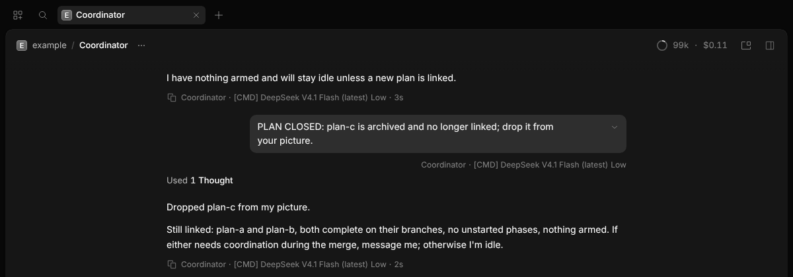

# User guide

This guide shows how to work with plan orchestrators day to day, run several plans in parallel under the coordinator, and release finished plans.

## Working with a plan orchestrator

A plan orchestrator is a long-lived chat that owns one plan from its scope to its last phase. You talk to it the way you would talk to a lead developer: you decide what the product should do, and it plans the phases, has each one detailed, implemented and reviewed by its own subagents, and keeps a handoff so it can pick up where it stopped. It works between your inputs, which may be hours or days apart.

Start a plan with `/plan-new`, which asks for the plan's name and creates its branch, its own working copy and its starting plan files. Then type `/plan <name>` to start its orchestrator. Typed in the workspace root, the command opens the orchestrator in a new chat in the plan's working copy, and the chat you typed it in stays as it was. Without a name, it offers the workspace's plans to pick from. The session list (Ctrl+O) opens any orchestrator's chat from any folder.

The orchestrator asks you for every product decision, each with its recommendation. Before an implementer starts, it gives a short rundown of what the phase changes and why it is ready. A phase that needs your own test stops there with numbered steps and the expected result of each.

The orchestrator waits only on a running process or on a coordinator hold. It never waits on a date or an outage. When its last phase is done, it reports the plan ready for its release.

### Shadow plans

When you want to build something interactively, one small change at a time, start a shadow plan with `/shadow-plan`. It asks for a name, creates the plan's branch and working copy with one cleanup phase, S1, already filled in, and opens a working chat there. Type `/shadow-register` in that chat to start the shadow orchestrator above it. You then work through your checklist and commit each item whose behavior you accept, and wake the shadow with `/shadow-wake` after each commit. It updates S1 so it always describes how to bring the accepted work up to the project's standards without changing it. When you stop, `/plan <name>` runs S1 like any other phase, and the release follows. S1's review rounds stand in for the closing survey, so a shadow plan has none.

### Autonomous mode

Tell an orchestrator to use autonomous mode when you want it to keep going without asking about routine choices. It then takes the decisions inside the plan's approved scope itself and records each one, with its reason and how to undo it, in the plan's decision record. Product decisions, your own tests and acceptance, and closing the plan come to you in either mode.

## Running plans in parallel

Each plan has its own branch and working copy, so several orchestrators can run side by side, each in its own chat. You keep working with each orchestrator exactly as with a single plan.

To keep two plans from building conflicting versions of the same code, link each orchestrator to the coordinator: type `/coordinator-link` in its chat once its first phase is detailed. The first link starts the coordinator in the workspace root. From then on the coordinator follows every round of the linked orchestrators in the background. You do not need to talk to it, but you can open its chat at any time to see what it noticed.

### When a plan is held

When the coordinator finds that two plans are about to change the same code, it holds both before their overlapping phases, and each orchestrator receives **HOLD ARMED** with the partner plan and the reason. Each orchestrator continues to that phase, stops there and tells you so in one line.

Once both have stopped, the coordinator opens a channel between the two orchestrators. The leading orchestrator agrees a shared design with its partner, then has a resolution phase written into each plan, one for what each branch still has to change. They settle the implementation details between themselves, and anything that changes how the product behaves comes to you, in the chat of the orchestrator that asks. When both resolution phases pass the leader's check, the leader closes the channel, the partner receives **RESOLVED**, and both plans continue on their own.

A plan is in one hold at a time. A second overlap with a held plan waits until the first is resolved.

### Shared resources

A workspace can name shared resources, such as a deployed instance or a worker machine, and the commands each lock guards. A session locks a resource before using it and unlocks it when its work is done, so two plans never use it at once. A guarded command is refused until the session or its parent holds the lock. A held lock can be queued for: it transfers to the first waiting session on release and wakes it. When a resource is taken, the session reports who holds it and why, and either waits, queues, or carries that work on as its own step. A session that keeps a lock, or the parent of a child session that keeps one, receives a reminder at the end of every round. A lock whose session was deleted or archived is released the next time any lock is used, and goes to the first waiting session.

### The orchestrators dialog

`/orchestrators`, typed in the workspace root, lists the linked orchestrators with whether each is running and its hold. Choose one to:

- **Unlink** it, which stops the coordinator from following it and leaves it working on its own.
- **Interrupt** its current round.
- **Archive** it, which unlinks it and hides it from the session list.

A plan that is held keeps its link until its hold is resolved. A plan that is closed unlinks itself.

## Releasing a plan

When a plan is ready, type `/release <name>` in the workspace root, or in the plan's own chat. It first brings the plan's branch up to date with the integration branch, so the review and the documentation cover the merged product. A hotfix skips that step because it already runs on the integration branch. The release reviews everything the plan changed, fixes documentation and presentation problems, reports product defects to you instead of fixing them, and asks you about the documentation's sections and titles. With your approval it merges the plan into the integration branch, resolves conflicts with plans that merged earlier by their shared designs and done contracts, runs the checks and closes the plan. Where the workspace deploys its private instance by hand, the release then deploys the integration branch there, under the instance's lock.

Run one release at a time. You make every public commit and push yourself, after the release's closing report.

`/release` typed in the integration branch's working copy starts a hotfix: a release with no plan, for work that belongs to no plan, such as a documentation pass over the whole product.
